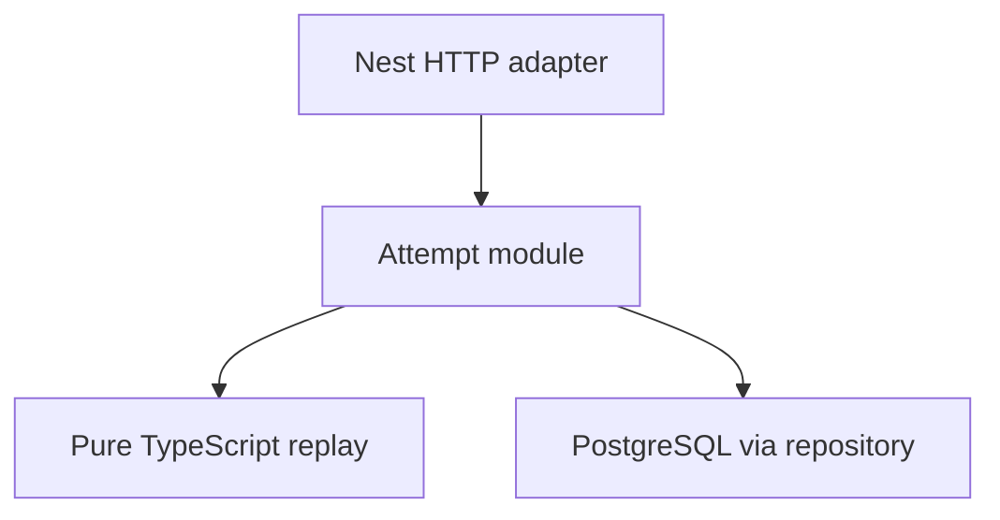

# ADR-005 — Application stack

Status: **Proposed**. Owner approval is required before this status becomes Accepted. This record selects an application stack only. It does not decide a host, create a database, or accept [ADR-001](ADR-001-service-isolation.md).

Jira: [PZD-14](https://puzzle-duel-app.atlassian.net/browse/PZD-14). Evidence: [PZD-14-EVIDENCE.md](../architecture/PZD-14-EVIDENCE.md). Parity: [PZD-14-GAMEPLAY-PARITY.md](../architecture/PZD-14-GAMEPLAY-PARITY.md).

## 1. Context

The backend must verify ranked attempts by replaying moves. A client score is not authoritative. The service needs modules, validation, transactions, and tests. Where that process runs, and how it is isolated from SportsDash, is [ADR-001](ADR-001-service-isolation.md) and depends on [PZD-12](https://puzzle-duel-app.atlassian.net/browse/PZD-12). PZD-12 has not been done. No host was inspected for this record.

## 2. Decision question

Which language, HTTP framework, and database should the Puzzle Duel application use, independent of the machine it is later deployed on?

## 3. Evaluated alternatives

| Alternative | Result |
| --- | --- |
| Node.js 26 Active LTS, TypeScript, NestJS 12, PostgreSQL 18 | Recommended application stack. |
| A smaller TypeScript HTTP framework alone, such as Fastify, Hono, or Express without Nest | Rejected as the primary structure. |
| NestJS on Node 20 or 22 because the local machine has Node 20 | Rejected as the target. Node 20 can run Nest 12 and cannot run the documented CLI generators. |
| SQLite as the ranked store | Rejected. Concurrent official attempts want a server database with explicit transactions. |
| PostgreSQL 14 | Rejected. Its listed final release date is 2026-11-12. |
| PostgreSQL 19 | Rejected. It was a release candidate on the versioning page, not a supported final major. |

Nest's own docs, from v12.3, recommend the `node:http` adapter and say it is not the default yet. The HTTP adapter is an implementation choice inside this stack. It is not a reason to pick a different framework. No adapter was benchmarked.

## 4. Evidence

Details and links are in [PZD-14-EVIDENCE.md](../architecture/PZD-14-EVIDENCE.md).

- Node.js 26 is Active LTS. 26.13.1 is dated 2026-11-10. Node 24 and 22 are Maintenance LTS.
- `@nestjs/core` 12.5.0 was the registry latest. `engines.node` is `>=20`. The version FAQ says applications run on Node 20.19+, or 22.12+ on the 22 line. CLI generators need 22.22.3+, 24.15+, or 26+.
- The Nest 12 migration guide says `nest upgrade` moves TypeScript to v6. This review did not generate a project, so no TypeScript patch is pinned.
- PostgreSQL 18.7 is the newest stable minor on the versioning page, supported until 2030-11-14. 17, 16, and 15 are also marked supported. 14's final release date is already past this review date.
- Local `node --version` printed v20.20.2. `nest new` was not run.

## 5. Constraints

- The replay function does not import Nest, the database, or the network. Nest calls it.
- Replay uses the attempt's stored `rulesVersion`. `core-001.v1` and `core-001.v2` are not interchangeable. See the parity document.
- A submitted score is ignored as authority. The stored score is the replay score.
- Identity and ranked-attempt protocol stay in [ADR-002](ADR-002-identity-and-linking.md) and [ADR-003](ADR-003-ranked-replay.md). This record does not expand them.
- No endpoint, schema, migration, or credential is added here.
- Host capacity, ports, proxy routes, and backup locations are not claimed. Those wait for PZD-12.

Proposed module split:

`replay` does not point at `db` or `http`.

## 6. Advantages and disadvantages

Nest provides modules, dependency injection, pipes for validation, guards for authentication interfaces, and a testing module. That matches a service with a hard boundary between HTTP and replay. The cost is framework weight, RxJS as a peer, and ESM rules that raise the Node floor.

A smaller HTTP library is less to learn and can be faster to boot. This review did not measure that. The cost of the smaller library is hand-built wiring for the same boundaries, transactions, and tests. For a ranked replay service those boundaries matter more than an unmeasured hello-world latency.

PostgreSQL gives transactions for the one-official-attempt rule. The disadvantage is operational cost, which PZD-12 must size. SQLite avoids a server and loses a clear concurrent writer story for ranked claims.

## 7. Security implications

Validation rejects malformed bodies before replay. Replay rejects illegal boards and unknown rulesets. Database access uses parameters and transactions. Idempotency keys are stored with the attempt so a retry cannot create a second official attempt. Logs must not contain provider tokens or raw credentials.

Authentication providers are not implemented here. The HTTP edge may depend on an authentication interface later. ADR-002 remains the identity proposal.

No secret is introduced by this document.

## 8. Testing and CI implications

Future jobs, not created here:

- Unit tests of the pure replay module against `v1` and `v2` fixtures.
- Negative fixtures and double replay, as in the parity document.
- Integration tests with a disposable PostgreSQL: one official attempt, conflicting concurrent claims, idempotent retry.
- Contract tests that the HTTP layer cannot persist a client score that disagrees with replay.

Ubuntu runners are sufficient for those jobs. This PR does not add them. The existing workflow only runs the Python and Node reference checkers for fixture paths. Documentation pulls do not get a new docs linter in CI.

## 9. Performance considerations

MVP boards are 5×5 to 7×7 with short move lists. Replay cost is small beside database transactions. No request-rate or query-time number was measured. Background workers are not required for replay. A later queue needs its own justification and is not part of this decision.

Connection pooling and statement timeouts belong to the deployment design after PZD-12. They are not tuned here.

## 10. Maintenance and cost implications

Node 26 Active LTS is the runtime target so the CLI generators and the application share one supported line. Nest and PostgreSQL majors are upgraded by later ADR or a reviewed bump, not by this document silently tracking latest.

Dollar cost of PostgreSQL and of GitHub minutes is **NOT_MEASURED**. PZD-12 must supply host capacity before anyone claims the service fits on existing hardware.

## 11. Migration and rollback

There is no production schema. Rollback of this proposal is owner rejection, with no data migration. When migrations exist later, each must have a down path or a documented expand/contract replacement. This ADR does not write those files.

Switching away from Nest later would keep the pure replay module and replace the HTTP shell. That is the reason the replay module must not import Nest.

## 12. Outstanding unknowns

- PZD-12: CPU, memory, disk, existing PostgreSQL, proxy, backups, and whether a new instance is required.
- HTTP adapter: Nest recommends `platform-node` from v12.3 and has not made it the default. Choose it at scaffold time unless a measured defect appears. No measurement exists.
- Exact TypeScript patch. The migration guide says v6. Pin the patch the Nest 12 toolchain resolves when scaffolding starts.
- Transport field names, status enums, and error strings. PD-13 did not freeze them.
- Early board-full end with an empty piece stream. Engines fail closed until a product decision exists.

## 13. Recommendation

Use NestJS 12 and TypeScript on Node.js 26 Active LTS, with PostgreSQL 18 as the application database. Keep replay in a pure TypeScript module. Do not treat a smaller HTTP framework as the primary structure. Do not deploy, create a database, or claim SportsDash capacity.

## 14. Owner-approval requirements

The owner decides whether this Proposed record becomes Accepted. Acceptance allows a later task to scaffold Nest and migrations. It does not authorize deployment, a host change, or acceptance of ADR-001. PZD-12 remains required before any isolation or capacity claim is accepted.
